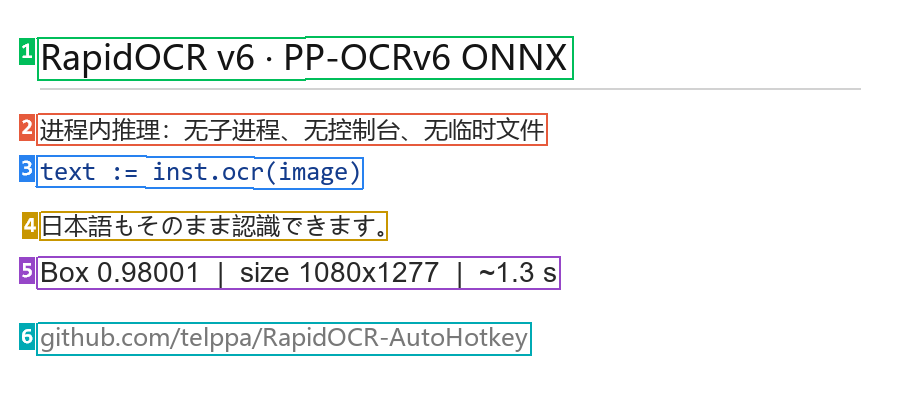

# RapidOCR for AutoHotkey

RapidOCR for AutoHotkey — PP-OCRv6 models supported.  
RapidOCR AHK 版：支持 **PP-OCRv6** 模型。



## How to use / 用法

```ahk
; initialize (default model PP-OCRv6 small)
; 初始化（默认模型 PP-OCRv6 small）
inst := new RapidOCR

; ocr img file ( bmp, dib, rle, jpg, jpeg, jpe, jfif, gif, tif, tiff, png )
; 识别本地图片（支持 bmp, dib, rle, jpg, jpeg, jpe, jfif, gif, tif, tiff, png 等格式）
MsgBox % inst.ocr("test\zh_hans.jpg")

; PDF file page 2
; 识别本地 PDF 第 2 页（index:-1 是最后一页）
MsgBox % inst.ocr({file:"test\en.pdf", index:2})

; ocr a screenshot
; 根据坐标截屏并识别
MsgBox % inst.ocr([0, 0, 100, 200])

; ocr the clipboard
; 识别剪贴板
MsgBox % inst.ocr(ClipboardAll)

; visualization: boxes + numbers of the last recognition
; 标注图：最近一次识别的检测框 + 编号
inst.vis_show("检测框预览")

; change parameters on the fly, only the keys you pass are replaced
; 运行中改参数，只覆盖传进来的键
inst.config({"text_score": 0.7})

#Include RapidOCR\RapidOCR.ahk
```

More usages, please refer to the sample files.  
更多用法（窗口、壁纸、鼠标、URL、base64、自定义模型…）请看 `1. ~ 12.` 示例文件。

## Compatibility / 兼容性

如果使用了本仓库的旧版（2025），那么有两处地方不再兼容。

1.是删掉了 `get_all_info` 参数：

| 旧版写法                                                                                    | 现在怎么写                                                                         |
| --------------------------------------------------------------------------------------- | ----------------------------------------------------------------------------- |
| `inst := new RapidOCR({"get_all_info": 1})`<br />`ocr() ; 返回 [{box, score, text}, ...]` | `inst := new RapidOCR()`<br />`inst.ocr_all() ; 返回 [{box, score, text}, ...]` |

2.是默认不再支持韩文。

原因是模型从 PP-OCRv4 升级到了 PP-OCRv6 ，而 v6 是多语言单模型，但多语言中不包含韩文。

其余一切与本仓库的旧版（2025）保持一致。

## Changelog / 变更记录

| 版本    | 日期         | 一句话                                                             |
| ----- | ---------- | --------------------------------------------------------------- |
| 1.8.1 | 2026-10-29 | AHK 拆成 `ocr` / `ocr_all`，删掉 `get_all_info`；DLL 版本号同步 1.8.1      |
| 1.8.0 | 2026-10-28 | 运行中改参数 `inst.config({...})`；DLL 加 `OCR_SetConfig`               |
| 1.7.0 | 2026-10-28 | 方法名统一成 `vis_*`（补回 `vis_base64`）；DLL 793 KB → 264 KB             |
| 1.6.1 | 2026-10-27 | AHK 删掉 `ocr_file` / `ocr_raw`，只留 `ocr()`；`runtime` 改名 `version` |
| 1.6.0 | 2026-10-27 | 标注图改成按需绘制；`visualize` 配置项删除；AHK 去 `_get`/`_num`                 |
| 1.5.1 | 2026-10-27 | 修浮点参数从 AHK 传不进 DLL；删掉 AHK 侧参数白名单与别名表                            |
| 1.5.0 | 2026-10-27 | 输入统一走 ImagePut Buffer；识别入口 3 → 2；visualize 返回 HBITMAP           |
| 1.4.0 | 2026-10-27 | 实现 `visualize`：返回带检测框和框编号的图                                     |
| 1.3.0 | 2026-10-27 | 只留 PP-OCRv6，删掉 v4 与韩文模型组                                        |
| 1.2.0 | 2026-10-27 | 加 `det_max_upscale` / `alpha_bg` / `alpha_retry` 三个参数           |
| 1.1.0 | 2026-10-26 | 修透明 PNG 合成与 EXIF 方向                                             |
| 1.0.0 | 2026-10-26 | 首个版本：C++ DLL 替代 `RapidOCR-json.exe` 子进程                         |

## Use the DLL directly / 直接用 DLL（非 AHK 语言）

<details>

<summary>展开 / Expand</summary>

导出的是纯 C ABI（x64，`__cdecl`）：

```c
const char* OCR_Version(void);
void*       OCR_Create(const char* utf8_json_cfg);      // 失败返回 NULL
const char* OCR_LastError(void);                        // 失败原因（UTF-8）

// 两个识别入口：本地图片文件 / 已经解好的像素
char* OCR_RunFile  (void* h, const wchar_t* path);            // WIC 解码（含 EXIF 纠正）
char* OCR_RunBuffer(void* h, const void* bgra, int w, int h, int stride);  // 32bpp BGRA，top-down

// 按需绘制最近一次识别的标注图（框 + 编号），返回 HBITMAP（调用方负责 DeleteObject）；
// 没识别过 / 上次识别失败时返回 NULL。重复调用命中缓存，不重复绘制。
void* OCR_VisBitmap(void* h);

// 运行中改配置：json 里出现的键覆盖当前配置，其余保持不变（增量）；
// 返回 0 成功，非 0 失败（原因见 OCR_LastError）。改到模型 / 线程 / 开关才
// 重建 session（0.2 秒上下），阈值、预处理之类立即生效。
int   OCR_SetConfig(void* h, const char* utf8_json_cfg);

void  OCR_FreeString(char* s);
void  OCR_Destroy(void* h);
```

配置串 JSON（键全部可选，不写就用默认值；传 `NULL` 或 `{}` 等于全默认）。同一份 JSON 也用于 `OCR_SetConfig` / `inst.config({...})`，  
那里只写要改的键即可，没写的保持原值：

```json
{
  "model_size": "small",

  "models": "",
  "det": "",
  "rec": "",
  "cls": "",
  "keys": "",

  "num_threads": 4,
  "rec_batch_num": 6,

  "use_det": 1,
  "use_rec": 1,
  "use_cls": 1,

  "padding": 0,
  "max_side_len": 2000,
  "min_side_len": 30,
  "alpha_bg": "auto",
  "alpha_retry": 1,

  "det_limit_side_len": 736,
  "det_limit_type": "min",
  "det_max_upscale": 3.0,
  "det_thresh": 0.3,
  "det_box_thresh": 0.5,
  "det_unclip_ratio": 1.6,
  "det_max_candidates": 1000,
  "det_use_dilation": 1,

  "rec_img_h": 48,
  "rec_img_w": 320,
  "text_score": 0.5,
  "use_vertical_padding": 1,
  "min_height": 30,
  "width_height_ratio": 8.0,

  "cls_img_h": 48,
  "cls_img_w": 192,
  "cls_thresh": 0.9
}
```

- `model_size`：`tiny` / `small` / `medium`，决定默认的 det / rec 模型；写错按 `small` 处理
- `models` / `det` / `rec` / `cls` / `keys`：模型目录与文件名，相对路径按 `models\` 解析；留空 = 按 `model_size` 自动取 `PP-OCRv6_det_<size>.onnx` / `PP-OCRv6_rec_<size>.onnx` / `ch_ppocr_mobile_v2.0_cls_infer.onnx`
- `alpha_bg`：透明图合成背景，`auto`（对比度自动）/ `drop`（丢 alpha）/ `white` / `black` / `space`（复现官方 HF space 的输入，含 R/B 互换）；`alpha_retry` = `auto` 模式识别全空且图确实带透明时，再按 `drop` 试一次
- `det_limit_type`：`min` 短边不足则放大，`max` 长边超限则缩小；`det_max_upscale`：短边放大上限，`0` = 不限制（完全等同原版 rapidocr）
- `det_thresh`：DB 像素阈值；`det_box_thresh`：框平均分阈值；`det_unclip_ratio`：框外扩比例
- `text_score`：识别置信度低于此值的行被丢弃（也不画框）
- `rec_img_h` / `rec_img_w`、`cls_img_h` / `cls_img_w`：识别 / 方向分类网络的输入尺寸，只有换自训练模型时才需要改；`cls_thresh` 是方向翻转的判定阈值
- `use_vertical_padding` / `min_height` / `width_height_ratio`：检测前对极扁、窄高图的处理（补到最小高度、限制宽高比），一般不用动
- `padding`：图像外周补白像素数，默认 `0`（旧版默认 50，仅为兼容保留）
- 旧版参数名仍然接受：`box_thresh`（= `det_thresh`）、`box_score_thresh`（= `det_box_thresh`）、`unclip_ratio`、`limit_side_len`、`limit_type`、`max_candidates`、`use_dilation`、`do_angle`（= `use_cls`）、`dict`（= `keys`）

`OCR_RunBuffer` 的像素格式与 `ImagePutBuffer(image)` 的输出一一对应：  
`buf.ptr` / `buf.width` / `buf.height` / `buf.stride`，内存布局 `B,G,R,A`、**非预乘**、自顶向下。  
其它语言（Python/Go/C#）只要把图转成这个布局就能直接用，不需要 PNG 中转。

返回的 JSON：

```json
{"code":100,
 "data":[{"box":[[169,45],[269,49],[268,98],[167,95]],"score":0.98,"text":"炼句"}],
 "elapse":{"det":693.05,"cls":17.01,"rec":641.49}}
```

`code`：`100` 有结果，`101` 无文本（`data` 为空数组）。

`elapse`：各阶段耗时。

</details>

## Thanks / 致谢

| 组件                                                       | 用途                               | 许可         |
| -------------------------------------------------------- | -------------------------------- | ---------- |
| [RapidOCR](https://github.com/rapidai/rapidocr)          | 内核与参数默认值来源（Python 版）             | Apache-2.0 |
| [PaddleOCR](https://github.com/PaddlePaddle/PaddleOCR)   | PP-OCRv6 模型、DB 后处理 / CTC 解码的算法出处 | Apache-2.0 |
| [ONNX Runtime](https://github.com/microsoft/onnxruntime) | 推理引擎（随包 `onnxruntime.dll`）       | MIT        |
| [ImagePut](https://github.com/iseahound/ImagePut)        | 图像输入输出统一入口，作者 iseahound          | MIT        |
| [cJson.ahk](https://github.com/G33kDude/cJson.ahk)       | AHK 侧 JSON 解析，作者 G33kDude        | MIT        |

`源码\` 下的 C++ 为本项目独立实现：图像解码走 Windows WIC，推理走 ONNX Runtime C API，  
检测后处理（DB 二值化、连通域、旋转卡壳最小外接矩形、miter 外扩）、透视裁剪、CTC 解码、  
双三次插值、GDI 画框均为自写代码，未复制上述项目的源码。

`RapidOCR.dll` 静态链接了 GCC 运行库（libstdc++ / libgcc，GPL-3.0 **with GCC Runtime Library Exception**），  
因此分发本 DLL 不构成 GPL 传染；未链接任何其它 GPL 组件。

PP-OCRv6 的 ONNX 模型来自 PaddleOCR 官方发布（Apache-2.0），允许再分发，保留版权与许可声明即可；  
若用于商业产品，建议自行复核 PaddleOCR 仓库中模型相关的最新条款。
